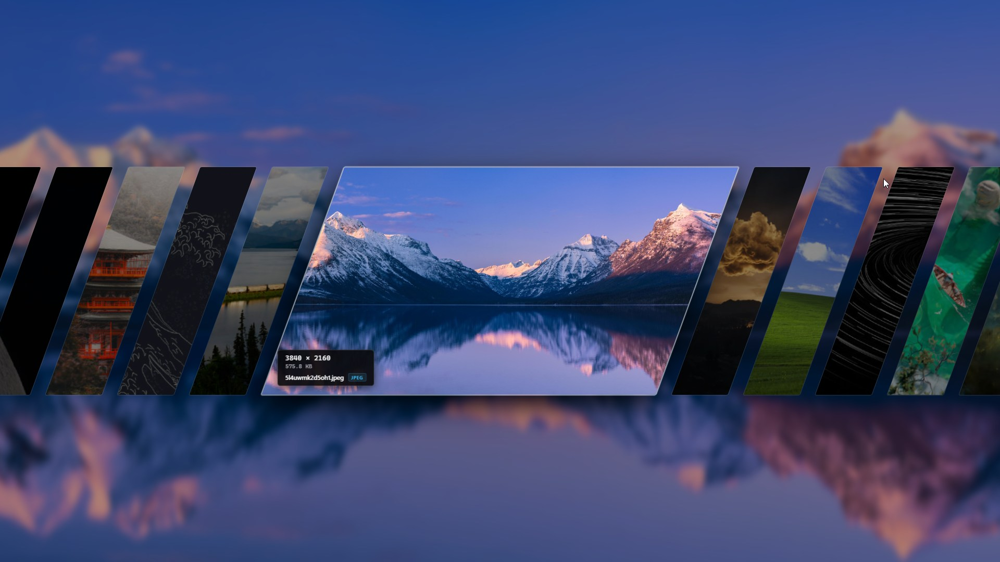

# Carousel



### Largely inspired by the wallpaper switcher in [ryoku](https://github.com/Ryoku-dev/ryoku) and [skwd-wall](https://github.com/liixini/skwd-wall)

[Ryoku-dev/ryoku](https://github.com/Ryoku-dev/ryoku)
[skwd-wall](https://github.com/liixini/skwd-wall)

## 1. Description

carousel is a desktop application for Windows that allows you to quickly change your wallpaper on the fly.
The application shows an overlay gallery to select and change desktop wallpapers.
The user opens the gallery with a global keyboard shortcut.
The user selects an image from a local folder to set the wallpaper.

## 2. System Requirements

Make sure that your computer meets these requirements:

- Operating System: Microsoft Windows 10 or Windows 11 (64-bit)
- Runtime: Microsoft Edge WebView2 (installed by default on Windows 10 and 11)
- Node.js: Version 18.0.0 or higher
- Rust toolchain: Stable channel (version 1.77.0 or higher)
- Build tools: Microsoft C++ Build Tools with Windows 10 or 11 SDK

## 3. Installation

Follow these steps to prepare and build the application:

1. Clone the repository to your local computer:

   ```shell
   git clone https://github.com/austinmusebe/carousel.git
   ```

2. Change to the project directory:

   ```shell
   cd carousel
   ```

3. Install the Node.js dependencies:
   ```shell
   npm install
   ```

## 4. Build Instructions

### 4.1 Development Mode

Start the application in development mode:

```shell
npm run tauri dev
```

The application compiles the Rust code and starts the local user interface.

### 4.2 Production Build

Create an optimized release executable:

```shell
npm run tauri build
```

The build output is located in:

```text
src-tauri/target/release/
```

### 4.3 GitHub Releases

The repository includes a GitHub Actions workflow in `.github/workflows/release.yml`.
The workflow runs automatically whenever a version tag (`v*`, e.g. `v0.6.0`) is pushed, and can also be triggered manually:

To create a release manually:

1. Open the repository on GitHub.
2. Click the `Actions` tab.
3. Select the `Release` workflow in the left sidebar.
4. Click `Run workflow`.
5. Enter the version tag (for example, `v0.6.0` or leave blank to auto-increment).
6. Click `Run workflow`.
7. When the build completes, the installer executable is attached to the GitHub Releases page.

## 5. Operation

### 5.1 Overlay Display

- Press `Alt+W` to show or hide the wallpaper gallery.
- The window hides automatically when it loses focus.
- Press `Esc` to hide the window immediately.
- The application continues to run in the background.

### 5.2 Navigation

- Press `Left Arrow` or `h` to show the previous image.
- Press `Right Arrow` or `l` to show the next image.
- Press `r` or `R` to reload the directory and check for new images.
- Turn the mouse wheel to scroll through images.
- Click an inactive card to center that image.

### 5.3 Color Filtering & Sorting

- Click any color swatch on the floating color bar to filter and sort wallpapers by dominant color (Red, Orange, Yellow, Green, Cyan, Blue, Purple, Pink, Brown, Black, Gray, White).
- Click **All** (or re-click the active swatch) to clear the color filter.
- In Cardflow mode, the color filter bar arches gracefully to match the curved card fan.

### 5.4 Set Wallpaper

- Press `Enter` to apply the active image as your desktop wallpaper.
- Alternatively, double-click the active image.
- The window hides automatically after you apply the wallpaper.

### 5.5 System Tray

The application shows an icon in the Windows notification area (system tray).

- Click the left mouse button on the tray icon to toggle the gallery.
- Click the right mouse button on the tray icon to open the context menu:
  - Select `Toggle Carousel` to show or hide the gallery.
  - Select `Settings...` to open the configuration window.
  - Select `Quit` to close the application completely.

## 6. Settings

The Settings window is organized into three tabs: **General**, **Display**, and **Animation**.

### 6.1 General Settings

#### Wallpaper Directory
1. Click `Browse`.
2. Select the folder that contains your wallpaper files.
3. Supported file formats: `.png`, `.jpg`, `.jpeg`, `.webp`.

#### Wallpaper Engine
Carousel can show your [Wallpaper Engine](https://store.steampowered.com/app/431960/) Workshop
subscriptions next to your image folder. A wallpaper folder is optional when this is enabled.

1. Turn on `Wallpaper Engine` in Settings, or click `Use Wallpaper Engine` on the setup screen.
2. The installation is detected through Steam. To use a different one, select the folder
   that contains `wallpaper64.exe`.
3. Click `Save changes`.

The gallery lists only your Workshop subscriptions, using each project's title and animated
preview. It does not list the built-in wallpapers or your own projects. New subscriptions appear
the next time you open the gallery, after Steam finishes downloading them. When you apply one:

- Carousel sends it to Wallpaper Engine through its
  [command line controls](https://help.wallpaperengine.io/en/functionality/cli.html).
- If Wallpaper Engine is not running, Carousel starts it first.
- The wallpaper opens on the first monitor only.

Applying a regular image while Wallpaper Engine is running closes the active Wallpaper Engine
wallpaper, so that the image is visible on the desktop.

#### Global Shortcut
1. Click an available preset (`Alt+W`, `Ctrl+Alt+W`, `Alt+Space`, `Ctrl+Shift+W`).
2. Alternatively, enter a custom key combination in the input field.
3. Click `Save changes` to apply the new shortcut.

#### Launch on System Startup
Toggle `Launch on system startup` to automatically start Carousel in the background when logging into Windows.

### 6.2 Display Settings

Select the gallery style and appearance in the **Display** tab:

| Style       | Layout                                                                |
| ----------- | --------------------------------------------------------------------- |
| Carousel    | Horizontal card stack with a center focus.                            |
| Shard       | Angled strips with one large card.                                    |
| Cardflow    | Fanned rounded cards.                                                 |
| Vinylflow   | Turntable record player with spinning vinyl and tonearm tracking.     |
| Depth       | Cards recede into the distance behind the active card.                |
| Geometric   | A field of tiles. Select the tile shape and the curve of the field.   |
| Wall        | A scrolling grid. Select one of six layouts.                          |
| Sandy       | A large preview above a strip. The old image blows away as sand.      |
| Card Hand   | Upright cards held in a wide arc.                                     |
| Collection  | One large card between two tilted piles.                              |
| Duel        | A slanted row of cards that narrow with distance.                     |
| Random      | A new style at each open. All styles appear before any repeat.        |

In Geometric and Wall, the arrow keys (or `h`, `j`, `k`, `l`) move in all four directions.

The Depth, Geometric, Wall, Sandy, Card Hand, Collection and Duel styles are original
recreations of the picker styles in [Ryoku](https://github.com/Ryoku-dev/ryoku) and
[skwd-wall](https://github.com/liixini/skwd-wall). They do not contain code from those projects.

#### Vinylflow Turntable Customization
When **Vinylflow** is selected, you can customize:
- **Turntable Chassis Skin**: Wood, Brushed Aluminum, Matte Carbon, or Vintage Cream.
- **RPM Speed**: 33 ⅓, 45, or 78 RPM record playback speed.
- **Tonearm Tracking**: Real-time tonearm angle tracking across record grooves with needle audio.

#### Background Blur
- **Blur Mode**: None, Window Blur (compact card backing), or Fullscreen Blur.
- **Blur Source**: Current desktop wallpaper or active wallpaper image.

### 6.3 Animation Settings

Select the transition animation style in the **Animation** tab, featuring live CSS animated preview cards:

| Animation Style   | Badge         | Description                                                            |
| ----------------- | ------------- | ---------------------------------------------------------------------- |
| Classic Slide     | Default       | Smooth linear sliding transitions between cards.                       |
| Zoom & Depth      | Scale + Depth | Centers scale up toward the viewer while receding side cards dim.     |
| Spring Bounce     | Dynamic       | Snappy elastic bounce with momentum overshoot and recoil.              |
| 3D Flip           | 3D Rotate     | Cards flip on their Y-axis with 3D perspective rotation.               |
| Crossfade Glide   | Soft Cross    | Subtle opacity crossfade blended with slight scaling.                  |
| 3D Cube Rotate    | Prism         | Revolves cards like facets around a deep 3D rotating prism drum.       |
| Parallax Slide    | Multiplane    | Multi-layer depth parallax with inner image counter-sliding motion.   |

### 6.4 Reload Directory Shortcut

Press `R` while the wallpaper gallery is open to check for newly added or removed images.
This shortcut is built into the application and cannot be changed.

### 6.5 Configuration Storage

The application saves settings in a JSON file at this location:

```text
%APPDATA%\com.carousel.app\config.json
```

## 7. Architecture

- **Frontend**: React, TypeScript, and Vite.
- **Backend**: Rust and Tauri v2.
- **Windows Integration**:
  - Sets desktop wallpapers through `SystemParametersInfoW` in the Win32 API.
  - Applies Wallpaper Engine wallpapers by running its `wallpaper64.exe -control` commands.
  - Does not use PowerShell processes.
  - Does not modify the Windows Registry directly.
  - Removes window title bars with `SetWindowLongPtrW`.
- **Image Processing**:
  - Uses the `rayon` crate for parallel directory scanning.
  - Extracts dominant colors from images for fast color filtering, with persistent sidecar caching.
  - Generates small in-memory JPEG thumbnails to reduce memory usage.
  - Loads full-resolution images through the Tauri asset protocol.
